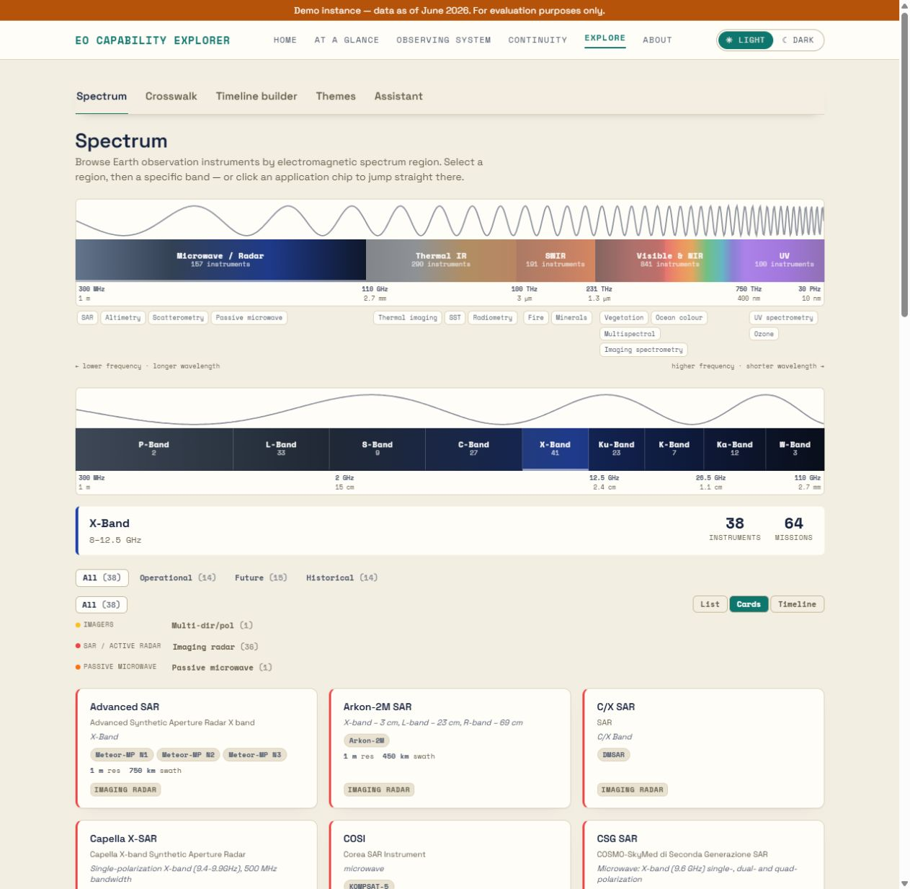
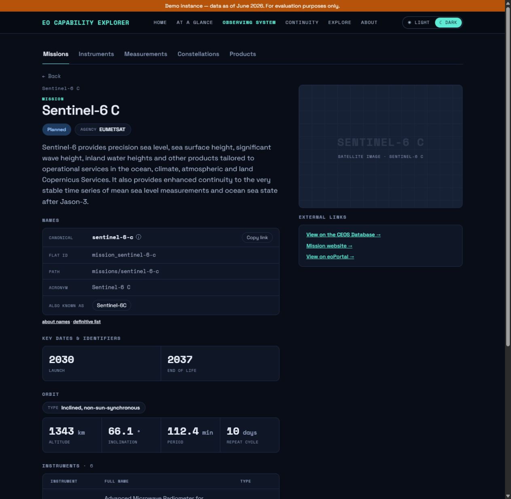
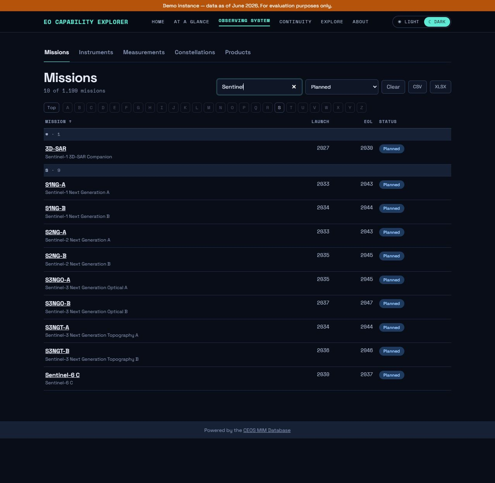
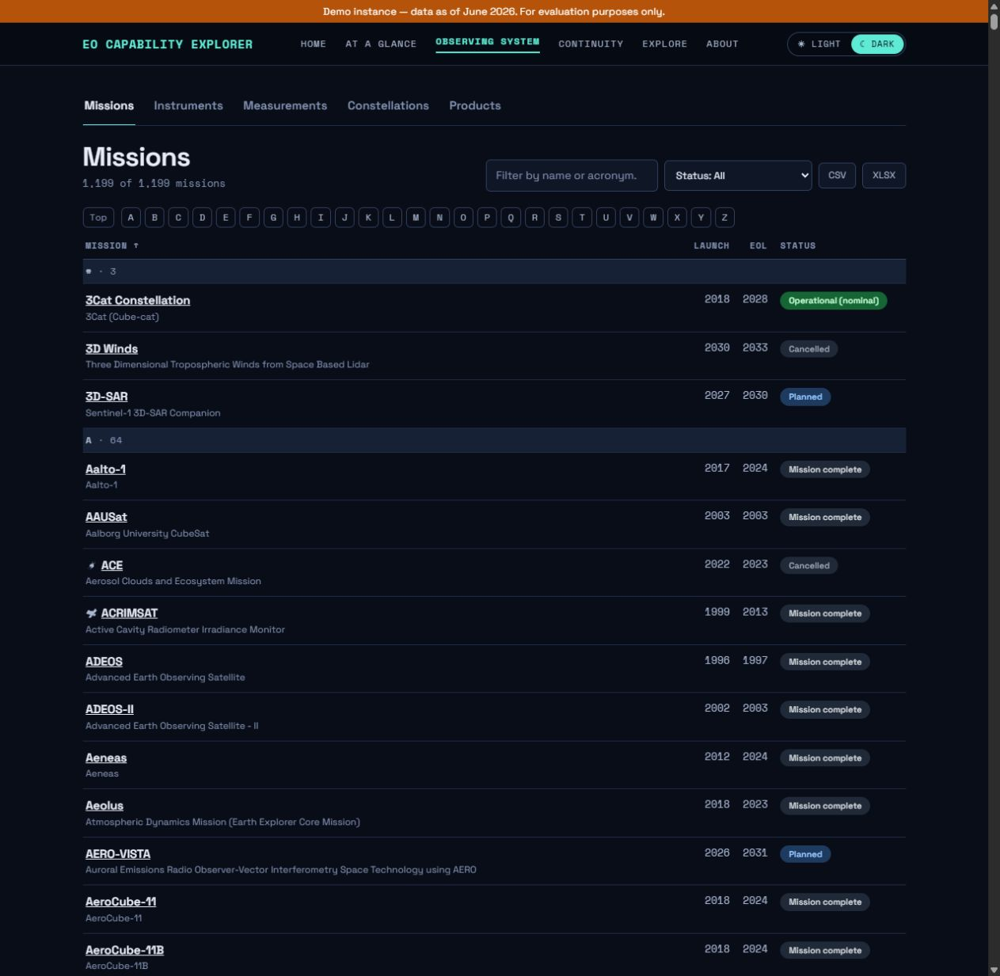
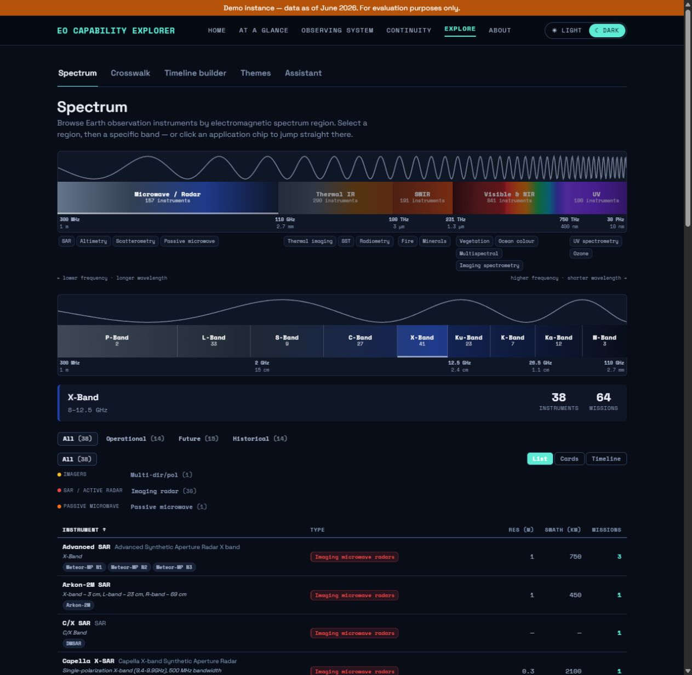
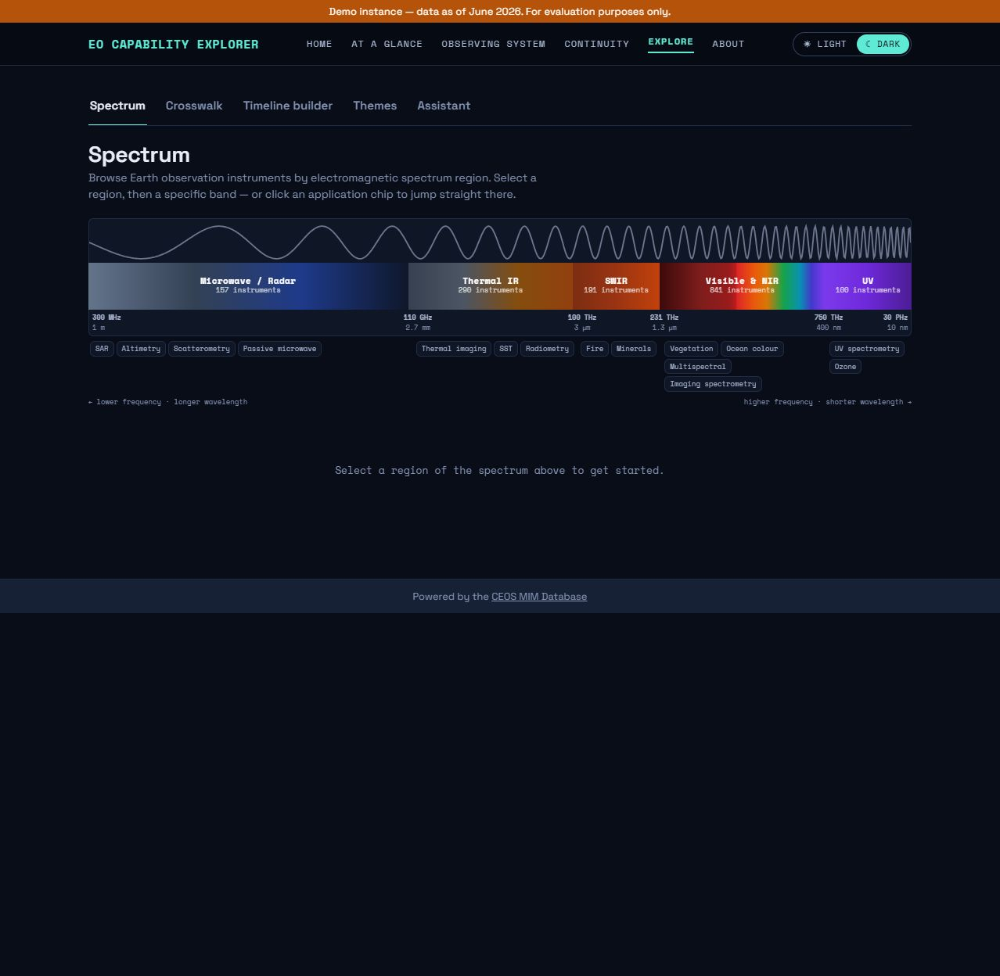
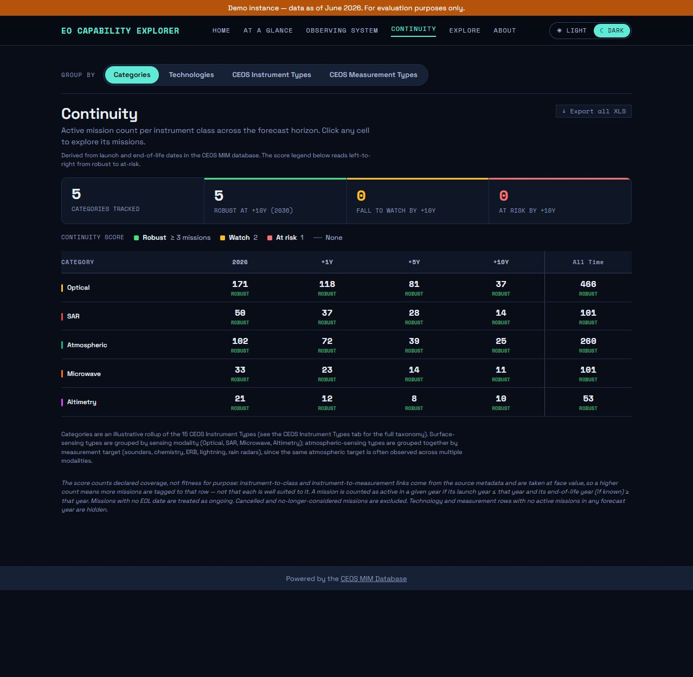
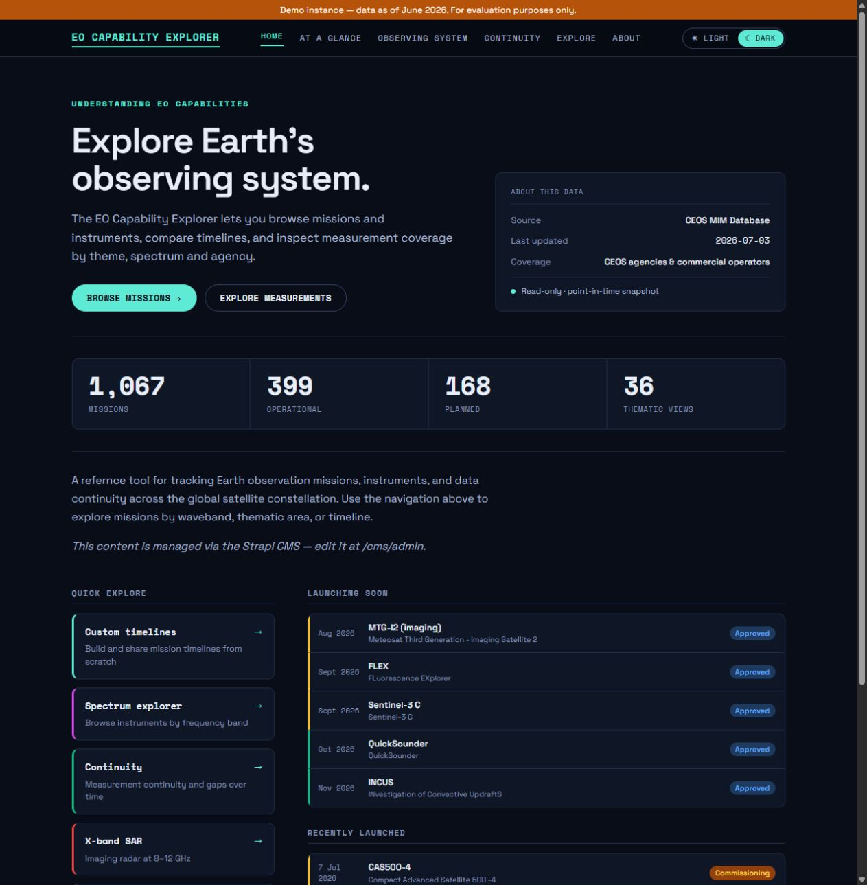

# EO Explorer visual reference for the Product Selection Tool

This guide answers one implementation question: **which parts of EO Explorer's design language should carry into a future redesign of the Product Selection Tool, and what practical rules reproduce that look in both light and dark themes?**

The guide is organised in four layers:

1. **Shared design system** - typography, layout, spacing, geometry, component anatomy, interaction and accessibility rules that remain consistent across both themes.
2. **Light mode** - the warm parchment palette, lower-contrast borders and softer elevation used specifically in light mode.
3. **Dark mode** - the navy-black surfaces, cool text hierarchy and stronger hover elevation used specifically in dark mode.
4. **Implementation reference** - reusable base tokens plus light and dark theme overrides.

Preserve the Product Selection Tool's content and workflow. Reuse EO Explorer's visual system, not its mission taxonomy, spectrum physics, continuity scoring or unrelated domain features.

## How to read the values

- **Inspected** means the value was read from EO Explorer in the browser or measured from a capture at a 1278 px viewport.
- **Approx.** means the screenshot supports the value, but it was not exposed as a single inspectable style.
- **Recommended adaptation** and **Inference** are proposals for the Product Selection Tool, not measurements from EO Explorer.

The captures support the rules but are not an exhaustive component specification. Shared rules appear first so developers do not accidentally build two separate interfaces when only colour and elevation should change.

# Part I - Styling shared across both themes

## 1. What remains consistent when the theme changes

EO Explorer is one component system with two visual skins. Theme switching changes colour roles, border contrast and shadow intensity; it does **not** change the information architecture or component geometry.

| Shared across light and dark | Theme-specific |
|---|---|
| Space Grotesk / Space Mono type roles | Canvas, navigation and panel colours |
| Heading, label, control and metric scale | Primary, secondary and muted text colours |
| 1052 px content frame and responsive grid | Standard and strong border colours |
| 12 / 16 / 20 / 24 px spacing rhythm | Accent shade needed for contrast |
| 6 / 10 / 14 / pill radius scale | Hover and raised shadow strength |
| Filter, chip, card, list and comparison anatomy | Semantic badge colour pairs |
| Active, hover, focus, selected and disabled semantics | Warm versus cool surface character |
| Global navigation plus contextual subnavigation | Theme-toggle selected state |

The most important implementation rule is therefore: **build component structure once and feed it semantic theme tokens.** Do not create separate light and dark versions of cards, filters or layouts.



*Figure 1 - Theme-independent structure: a stable content frame, compact controls, counted filters, a view switch and equal result cards. Light mode changes the visual skin, not the component anatomy.*

## 2. Shared typography

EO Explorer uses **Space Grotesk** for headings and prose and **Space Mono** for data, labels, chips, counts and compact controls. This pairing is a defining part of the design language in both themes.

| Style | Inspected specification | Product Selection Tool use |
|---|---|---|
| Body | Space Grotesk, `16px/24px`, weight `400` | Descriptions and explanatory text |
| Hero | Space Grotesk, `52px/54.6px`, weight `600`, tracking `-1.3px` | Rare landing or overview statement |
| Page H1 | Space Grotesk, `34px/40.8px`, weight `600` | Discover, Profile Builder and Compare titles |
| Subsection heading | Space Grotesk, `28px/33.6px`, weight `600` | Major result or detail section |
| Card title | Space Grotesk, `14px/18.9px`, weight `600` | Compact result identity |
| Label | Space Mono, `12px/14.4px`, weight `600` | Eyebrows and field labels |
| Control text | `13-14px` | Inputs, selects, tabs and buttons |
| Chip text | Space Mono, `9-12px` | Status and filter pills |
| Large metric | Space Mono, `38px/38px`, weight `700` | A small number of headline values |

**Recommended adaptation:** use the 34 px H1 for working views and reserve the 52 px hero for an entry or overview page. Use sentence case for headings and controls. Reserve monospaced uppercase for short technical labels, never full paragraphs.

## 3. Shared layout and spacing

The inspected desktop pages use a centred **1052 px content area at a 1278 px viewport**, below a **55 px global navigation bar** and a **45 px contextual subnavigation bar**.

The recurring spacing rhythm is **12 / 16 / 20 / 24 px**:

- `12px` for tight control groups, label-to-value gaps and compact metadata.
- `16px` for normal component gaps and card-grid gutters.
- `20-24px` between distinct content groups and sections.
- `48px` only for major desktop column separation.

| Pattern | Inspected measurement |
|---|---:|
| Three-column result card | `340px` wide, `169-185px` high |
| Card grid gutter | `16px` |
| Card padding | `16px 18px` |
| Summary strip | `1052px x 68px`, padding `12px 16px` |
| Dense catalogue row | Approx. `61.5px` high with `1px` separators |
| Detail columns | `594px + 48px gap + 410px` |
| Detail identifier panel | Approx. `594px x 218px` |
| Detail side-link panel | Approx. `410px x 105px` |
| Comparison matrix | Approx. `1052px x 304px`, cell padding `15px 18px` |

The responsive card system is full width by default, two columns at the small breakpoint and three columns at the medium breakpoint. A **767 px breakpoint** and **44 px mobile interaction targets** were inspected.

**Recommended adaptation:** beneath 767 px, stack filter groups and detail columns, allow chip groups to wrap, and let comparison tables scroll horizontally with clear headers. Sticky first columns or summary regions may help, but stickiness was not established by the inspection and should be usability-tested.

## 4. Shared geometry and surface hierarchy

EO Explorer uses a short radius scale in both themes:

- `6px` - inputs, selects, compact controls and summary strips.
- `10px` - result cards, preset tiles and substantial panels.
- `14px` - larger soft-edged containers needing extra separation.
- `999px` - status badges and segmented selections.

Surfaces follow a consistent hierarchy:

1. Canvas establishes the application background.
2. Navigation is visually distinct from the canvas.
3. Panels and cards group information with a 1 px rule.
4. Raised or hover surfaces identify interaction without moving layout.
5. Accent is reserved for selection, action, focus and active navigation.

The geometry remains unchanged across themes. Only the semantic values for canvas, panel, border, text and shadow should change.

## 5. Shared navigation and information hierarchy

EO Explorer separates navigation into two flat rows:

- A **55 px global navigation bar** for the site's major destinations.
- A **45 px contextual subnavigation bar** for the current domain or workflow.

Inactive links use secondary text. The current route uses stronger or accent text plus a thin accent underline. Filled pills are reserved for segmented controls such as theme or result-view switching, not for every navigation item.

Page hierarchy is consistent in both themes:

1. Contextual navigation.
2. Page title or entity eyebrow and title.
3. Summary, explanation or result count.
4. Controls and active criteria.
5. Results, detail panels or comparison content.
6. Low-emphasis provenance or footer information.



*Figure 2 - The detail hierarchy is theme-independent: back action, identifier, eyebrow, title, status, summary, grouped facts, metrics and secondary links.*

## 6. Shared buttons, filters and form controls

| Control | Inspected dimensions and styling |
|---|---|
| Primary CTA | Approx. `184 x 40px`; pill; Space Mono `12.8px/600`; padding `9.6px 21.6px` |
| Search input | `220 x 41px`; radius `6px`; `14px` text; padding `9px 12px` |
| Select | `189 x 39px`; `13px` text; padding `9px 10px` |
| Compact plain action | Approx. `48 x 33px`; radius `6px`; `12px` text |
| Alphabet index item | Approx. `25 x 26px`; radius `6px`; Space Mono `12px`; padding `3px 8px` |
| Filter chip | `24.5px` high; radius `6px`; Space Mono `11px/600`; padding `3px 10px` |
| Selected segment | Approx. `100 x 31.5px`; pill; `13px/600`; padding `6px 16px` |

Shared interaction rules:

- One solid primary action per action cluster; adjacent utilities use the quieter bordered style.
- Hover strengthens the border and, for cards, adds elevation without layout movement.
- Pressed filter chips use accent fill, accent border and the theme's canvas colour for text.
- Keyboard focus uses a **2 px accent outline with a 2 px offset**.
- Active search criteria expose an inline remove action and a visible **Clear** action.
- Result counts update close to the filters that affected them.
- Toggle-like controls expose pressed state; segmented views use tab semantics.
- Status and selection always use text or an icon in addition to colour.
- Query and view state may persist in the URL so filtered views are restorable.



*Figure 3 - Canonical shared filter behaviour: criteria remain visible and reversible, while the nearby count confirms their effect.*

## 7. Shared cards, lists and workflow patterns

### Result cards

Use equal `340px` cards when a result needs a title, compact status set and two or three metadata facts. Shared anatomy:

1. Category or identity marker.
2. Short title.
3. One-line description.
4. Compact chips or status.
5. Two or three comparable facts.
6. Clear selection or detail action.

Resting cards use a panel surface, 1 px border, 10 px radius and no permanent layout movement. Hover and focus should be visible in either theme. **Inference:** selected cards should add explicit selected text or icon plus an accent ring; disabled cards should remain readable, explain unavailability and suppress hover elevation.

### Preset and profile tiles

The Quick Explore tiles are approximately **299 x 97 px**, with a 10 px radius and `15px 17px` padding. Their title, one-line explanation and full-tile interaction map well to Product Selection Tool profile presets.

### Dense result rows

Use the approx. 61.5 px row system when users must scan many products using the same attributes. Alignment, 1 px rules and muted group bars replace repeated card chrome.



*Figure 4 - Dense lists use alignment, separators and group headers instead of turning every item into a floating card.*

### Filter-to-results progression

Use the sequence: **selected scope -> 68 px summary strip -> counted chips -> view control -> aligned results**. This creates a visible bridge between inputs and outputs.



*Figure 5 - Keep selected scope and counts directly above results; users should not have to remember which inputs produced the list.*

### Guided empty state

Keep selection context visible and provide one specific next action. Do not replace the working layout with a generic illustration.



*Figure 6 - The empty state belongs inside the workflow so users can understand and revise the selection that caused it.*

### Comparison

Comparison should prioritise alignment over ornament: full-width columns, repeated labels, right-aligned numbers, restrained rules and text-plus-colour states.



*Figure 7 - Apply the scanability to product comparison, but do not import EO Explorer's continuity scoring or methodology.*

# Part II - Light mode specific styling

## 8. Light mode character

Light mode is deliberately **warm and editorial**, not pure white or cool grey. The parchment canvas softens the data-heavy interface, while deep navy text and a darker teal accent preserve contrast.

Use light mode when the Product Selection Tool should feel approachable, document-like or comfortable in a bright workspace. Preserve the same density and geometry as dark mode; do not add extra whitespace merely because the theme is lighter.

## 9. Light mode palette

All values below are **inspected**.

| Role | Value | Specific use |
|---|---:|---|
| Canvas | `#f3eee2` | Warm application background |
| Navigation / panel | `#fffdf8` | Header, cards and grouped content |
| Raised / hover surface | `#eae2d1` | Hovered rows, cards and emphasis |
| Primary text | `#16233f` | Headings, values and selected labels |
| Secondary text | `#4a5468` | Body copy and supporting values |
| Muted warm text | `#635c49` | Low-emphasis labels and metadata |
| Standard rule | `#ddd4c0` | Borders and dividers |
| Strong rule | `#c4b99d` | Hover and stronger separation |
| Accent | `#0f766e` | Primary actions, selection and focus |
| Raised shadow | `0 14px 34px -10px rgba(20, 33, 61, 0.2)` | Light-theme interactive elevation |

## 10. Light mode application rules

- Use `#f3eee2` as the page canvas and `#fffdf8` for panels; avoid pure `#ffffff` as the default background.
- Use the darker `#0f766e` teal for contrast. Do not reuse the brighter dark-mode turquoise on warm light surfaces.
- Keep borders visible but quiet. `#ddd4c0` is the default; reserve `#c4b99d` for hover or stronger grouping.
- Use `#16233f` for headings and selected values. Reserve `#635c49` for nonessential metadata.
- Use shadow sparingly. The softer, broader light shadow should identify an interactive raised state rather than decorate every card.
- Preserve panel geometry, padding, card grid, chip size and control height exactly when switching themes.


*Figure 8 - Light mode is a warm token translation of the shared system. Geometry, density and control placement remain unchanged.*

# Part III - Dark mode specific styling

## 11. Dark mode character

Dark mode is EO Explorer's more overtly technical expression. It uses a near-black navy canvas, slightly lighter blue panels, cool off-white text and a bright mint accent. Thin borders do most of the grouping; strong shadow appears only at interactive elevation points.

Use dark mode when the Product Selection Tool should feel analytical, operations-focused or comfortable in a low-light environment. Avoid flattening everything into one black surface: the small difference between canvas, navigation, panel and raised surface is essential.



*Figure 9 - Dark mode establishes the technical tone through layered navy surfaces, cool text and selective mint emphasis.*

## 12. Dark mode palette

All values below are **inspected**.

| Role | Value | Specific use |
|---|---:|---|
| Canvas | `#080d18` | Page background |
| Navigation | `#060a12` | Global navigation shell |
| Panel | `#0f1626` | Cards, strips and grouped content |
| Raised / hover surface | `#172136` | Hovered or visually elevated regions |
| Primary text | `#e8eef7` | Headings and important values |
| Secondary text | `#a8b6d0` | Body copy and supporting values |
| Muted text | `#8493b3` | Labels and low-emphasis metadata |
| Standard rule | `#202b45` | Borders and dividers |
| Strong rule | `#30405f` | Hover and stronger emphasis |
| Accent | `#5eead4` | Primary actions, active states and focus |
| Warning | `#fbbf24` | Warning or planned emphasis |
| Error | `#f87171` | Errors and destructive emphasis |

## 13. Dark mode application rules

- Keep `#060a12` navigation distinct from the `#080d18` canvas.
- Use `#0f1626` for cards and panels, then `#172136` for hover or raised emphasis.
- Dark cards have **no resting shadow**. Their inspected hover treatment is:

```css
box-shadow: 0 10px 30px rgba(0, 0, 0, 0.55),
            0 0 0 1px #30405f;
```

- Use `#e8eef7` for headings and critical values, `#a8b6d0` for normal supporting content and `#8493b3` only for low-priority metadata.
- Keep the bright `#5eead4` accent scarce. It works because the rest of the interface remains neutral.
- Use `#202b45` for default borders and `#30405f` for hover or stronger grouping.
- Avoid pure black panels and pure white body copy; the cool navy and off-white values preserve surface separation and reduce glare.

## 14. Dark mode semantic states

Status styles pair text with colour. Treat these as examples of state construction, not as a mandatory Product Selection Tool vocabulary.

The inspected Planned badge is approximately **73 x 30 px**, with pill radius, `12px/600` text and `4px 13px` padding. Every badge should retain a readable label so colour is never the only signal.

| Status example | Background | Foreground |
|---|---:|---:|
| Planned | `#1e3a5f` | `#93c5fd` |
| Nominal | `#166534` | `#bbf7d0` |
| Extended | `#14532d` | `#86efac` |
| Commissioning | `#92400e` | Not captured as a separate inspected token |
| Considered | `#131a2b` | `#94a3b8` |
| Cancelled | `#1f2937` | `#9ca3af` |

# Part IV - Implementation reference

## 15. Reusable design tokens

The literal values are **inspected**. The semantic variable names and grouping are a **recommended adaptation**. Shared values live in `:root`; only visual roles change per theme.

```css
:root {
  --eo-radius-control: 6px;
  --eo-radius-card: 10px;
  --eo-radius-panel: 14px;
  --eo-radius-pill: 999px;

  --eo-space-1: 12px;
  --eo-space-2: 16px;
  --eo-space-3: 20px;
  --eo-space-4: 24px;

  --eo-content-max: 1052px;
  --eo-grid-gap: 16px;
  --eo-nav-height: 55px;
  --eo-subnav-height: 45px;
  --eo-focus-width: 2px;
  --eo-focus-offset: 2px;
  --eo-mobile-target-min: 44px;

  --eo-font-sans: "Space Grotesk", sans-serif;
  --eo-font-mono: "Space Mono", monospace;
  --eo-font-size-body: 16px;
  --eo-line-height-body: 24px;
  --eo-font-size-page-title: 34px;
  --eo-line-height-page-title: 40.8px;
  --eo-font-size-label: 12px;
  --eo-line-height-label: 14.4px;
}

[data-theme="light"] {
  --eo-canvas: #f3eee2;
  --eo-nav: #fffdf8;
  --eo-panel: #fffdf8;
  --eo-raised: #eae2d1;
  --eo-text: #16233f;
  --eo-text-secondary: #4a5468;
  --eo-text-muted: #635c49;
  --eo-line: #ddd4c0;
  --eo-line-strong: #c4b99d;
  --eo-accent: #0f766e;
  --eo-shadow-card-hover: 0 14px 34px -10px rgba(20, 33, 61, 0.2);
}

[data-theme="dark"] {
  --eo-canvas: #080d18;
  --eo-nav: #060a12;
  --eo-panel: #0f1626;
  --eo-raised: #172136;
  --eo-text: #e8eef7;
  --eo-text-secondary: #a8b6d0;
  --eo-text-muted: #8493b3;
  --eo-line: #202b45;
  --eo-line-strong: #30405f;
  --eo-accent: #5eead4;
  --eo-warning: #fbbf24;
  --eo-error: #f87171;
  --eo-shadow-card-hover: 0 10px 30px rgba(0, 0, 0, 0.55),
                          0 0 0 1px var(--eo-line-strong);
}
```

Components consume only semantic values:

```css
.focusable:focus-visible {
  outline: var(--eo-focus-width) solid var(--eo-accent);
  outline-offset: var(--eo-focus-offset);
}

.result-card {
  padding: 16px 18px;
  border: 1px solid var(--eo-line);
  border-radius: var(--eo-radius-card);
  color: var(--eo-text);
  background: var(--eo-panel);
  box-shadow: none;
}

.result-card:hover {
  background: var(--eo-raised);
  box-shadow: var(--eo-shadow-card-hover);
}
```

## 16. Applying the reference to the Product Selection Tool

Prioritise implementation in this order:

1. **Shared foundation:** build the typography roles, content frame, spacing rhythm, radii, component geometry, interaction states and accessibility once.
2. **Semantic theming:** apply light and dark values through theme tokens rather than component-level colour overrides.
3. **Discover:** map EO Explorer's search, filters, active criteria, counts and summary strip to product discovery.
4. **Profile Builder:** use Quick Explore-style preset tiles and compact refinement controls with explicit selection.
5. **Results:** use dense rows for attribute scanning and equal cards for browsing; preserve the same structure in both themes.
6. **Product detail:** reuse the identity-first hierarchy and grouped key-value or metric panels.
7. **Compare:** use full-width aligned columns, repeated labels, restrained dividers and text-plus-colour states.
8. **Responsive and accessibility pass:** stack below 767 px, retain 44 px mobile targets, use pressed or tab semantics, and test focus and contrast in both themes.

The EO Explorer signature is not a single colour. It is the combination of compact technical typography, stable geometry, shallow surface layering, precise alignment and explicit state feedback. Build those qualities once; let light mode express them through warm parchment and restrained depth, and let dark mode express them through layered navy surfaces and selective mint contrast.
